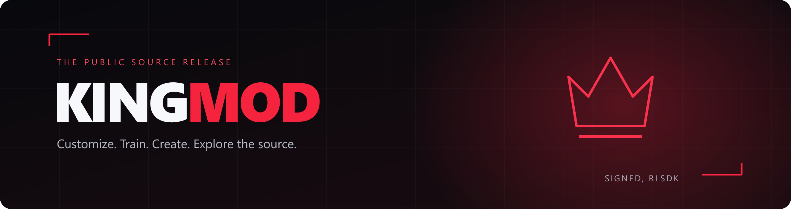

<div align="center">



**A Rocket League modding workspace for customization, training, workshop maps, and local experimentation.**


[Explore the showcase](showcase/README.md) · [Build from source](#build-from-source) · [Report an issue](https://github.com/KingMod2008/KingModSourceCode/issues)

</div>

> **KingMod is free and open source. If you paid anyone for this mod, you were scammed.**  
> **Signed, rlsdk**

## Make it yours

A dark interface with red accents brings the tools together: design a loadout, change the look of the game, practice a shot, explore a workshop map, or set up a local session. The source is here to inspect, build, and learn from.

No license key or authentication server is required for this public build.

## Showcase

Screenshots supplied by the project author. Click an image to open it at full resolution. Settings shown in screenshots may differ from the public build defaults.

<table>
<tr><td width="50%"><a href="showcase/11-workshop-browser.png"></a><br><b>Discover workshop maps</b></td><td width="50%"><a href="showcase/26-custom-paint.png"></a><br><b>Build your own look</b></td></tr>
<tr><td><a href="showcase/32-ball-prediction.png"></a><br><b>Explore training visuals</b></td><td><a href="showcase/46-cinematic-mode.png"></a><br><b>Frame the perfect shot</b></td></tr>
<tr><td><a href="showcase/48-training-lab.png"></a><br><b>Practice with purpose</b></td><td><a href="showcase/60-ui-customization.png"></a><br><b>Customize your workspace</b></td></tr>
</table>

**[View all 60 screenshots →](showcase/README.md)**

## Inside KingMod

| Area | Tools in the source |
| :--- | :--- |
| **Garage & titles** | Item browsing, local loadout overrides, custom paint, wheels, underglow, custom models, and title customization |
| **Textures** | Ball textures, avatars, decals, banners, and boost meter skins |
| **Training & TAS** | Checkpoints, shot presets, session analytics, recording, replay, and practice controls |
| **Visuals** | RocketSim ball prediction, minimap, speed displays, hitboxes, input overlays, HUD colors, and more |
| **Workshop** | Community map browsing, downloads, installed-map management, and a local launcher |
| **Local servers** | LAN hosting/joining, host controls, physics settings, bots, and optional peer presence |
| **Camera** | Camera presets, photo mode, slow motion, freecam, and camera paths |
| **Tools & settings** | Presets, feature profiles, automation, theme controls, hotkeys, and debugging views |

Feature names describe the included source and UI. Cosmetic/account previews are not a promise of server-side ownership, currency, rank, or progression. Local physics and host controls are limited to supported offline or hosted sessions.

## Build from source

### Requirements

- Windows x64 and Visual Studio C++ build tools with a Windows SDK.
- **MSVC v145** for the supplied Release configuration; Debug currently targets **v143**.
- C++20 support and Git for Windows.
- vcpkg with the `x64-windows-static` triplet.

In your vcpkg directory:

```powershell
.cpkg install curl:x64-windows-static openssl:x64-windows-static zlib:x64-windows-static detours:x64-windows-static minhook:x64-windows-static
.cpkg integrate install
```

Clone the project, then build from a Visual Studio developer terminal:

```powershell
git clone https://github.com/KingMod2008/KingModSourceCode.git
cd KingModSourceCode
msbuild KingMod.sln /m /p:Configuration=Release /p:Platform=x64
```

Or open `KingMod.sln`, select **Release | x64**, and build the solution.

**RocketSim builds automatically as a project dependency.** You do not need to find or download a separate `RocketSim.lib`. FreeType and Discord RPC build dependencies are bundled.

The DLL output is normally `x64/Release/KingMod.dll`. See [BUILDING](BUILDING) for additional build details and the standalone RocketSim build.

### Optional integrations

[PublicConfig.hpp](PublicConfig.hpp) provides empty defaults for `KINGMOD_DISCORD_APPLICATION_ID` and `KINGMOD_PSYNET_SIGNING_KEY`. Configure your own values locally if you need those integrations; never publish private keys. Discord RPC and response signing remain disabled with the empty defaults.

## Updating KingMod for a new game version

To update KingMod after a Rocket League update, use **[RLSDKGenerator](https://github.com/KingMod2008/RLSDKGenerator)** to generate an SDK for the game version you are targeting.

1. Follow the generator's README to configure and build it. Verify its discovery patterns, offsets, and layouts against your game version.
2. Generate fresh `SDK_HEADERS` and `SDK_SOURCE` files, then compare them with the corresponding folders in KingMod's `RLSDK/` directory.
3. Merge the updated SDK into those folders, preserving any KingMod-specific additions. Keep the Discord RPC integration in `RLSDK/RPC_DISCORD/` intact.
4. Review KingMod's own patterns, offsets, hooks, and calls for changes, then rebuild **Release | x64** and test the affected features.

Generating a fresh SDK is part of updating the mod; it does not automatically update KingMod's hooks or guarantee compatibility with a new game version.

## Find your way around

```text
Components/       Startup, UI, game state, inventory, and services
Modules/          Mod features, visuals, training, workshop, and LAN tools
RLSDK/            Rocket League SDK and Discord RPC bridge
RocketSim/        Simulation source and automatic Visual Studio dependency
ImGui/            Interface and rendering code
Extensions/       Shared memory, formatting, math, and color helpers
CollisionMeshes/  Simulation collision assets
showcase/         Screenshots and the complete visual gallery
```

## Before you run a build

This is an independent project, not affiliated with or endorsed by Psyonix or Epic Games. Review the code and applicable game rules before use. Game updates can break SDK offsets and hooks; screenshots are not a compatibility guarantee.

The [security review](SECURITY_REVIEW) records the checks performed and their limits. Optional webhooks can send match data, LAN features open sockets, and debugging dumps may contain account/session information. A source review is not a guarantee of safety or antivirus clearance.

## Credits & notices

**KingMod — signed, rlsdk.**

Includes RocketSim, Dear ImGui, FreeType, Bullet, Discord RPC, and other third-party components. Retain their [notices](THIRD_PARTY_NOTICES) and [RocketSim license](RocketSim/LICENSE). No project-wide license has been selected in this source tree; third-party licenses continue to apply to their respective components.

---

<div align="center">

**Free to download. Source to explore. KingMod.**  
** my last word , dont forget palestine! ** 
[Back to top ↑](#)

</div>

**Don't forget Palestine! 🇵🇸**
